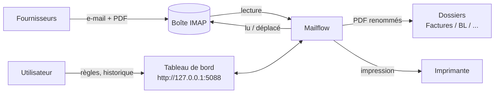
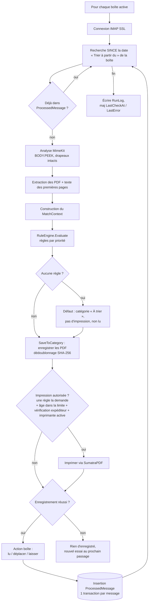
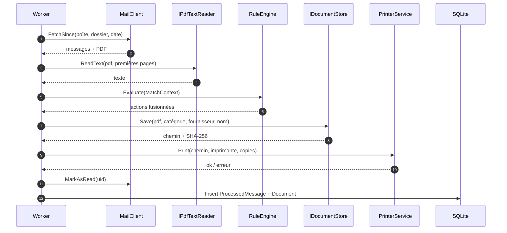
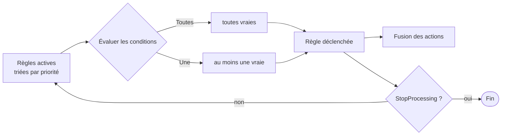
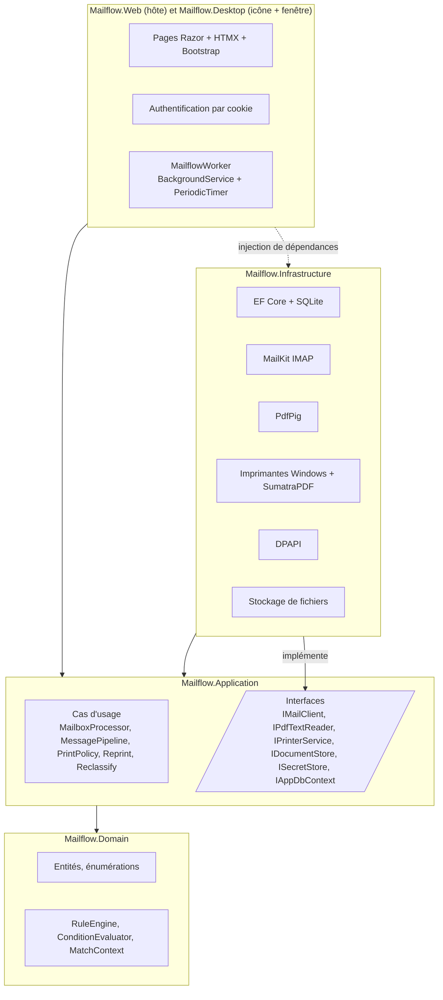

# Mailflow

**Français** | [English](README.md)

**Triez vos e-mails, archivez les PDF reçus et imprimez automatiquement ceux que vous choisissez.**
Gratuit, léger, open source (MIT). Windows, .NET 10.

> **Statut :** version préliminaire. Lisez le modèle de sécurité ci-dessous avant de vous fier à l'impression automatique.

## Sommaire

1. [Présentation](#présentation)
2. [Fonctionnalités](#fonctionnalités)
3. [Fonctionnement](#fonctionnement)
4. [Démarrage rapide](#démarrage-rapide)
5. [Configuration](#configuration)
6. [Règles](#règles)
7. [Modèle de sécurité](#modèle-de-sécurité)
8. [Architecture et pile technique](#architecture-et-pile-technique)
9. [Structure du dépôt](#structure-du-dépôt)
10. [Compiler, tester, publier](#compiler-tester-publier)
11. [Feuille de route](#feuille-de-route)
12. [Contribuer et licence](#contribuer-et-licence)

## Présentation

Mailflow tourne sur un PC Windows toujours allumé. Il :

1. **Lit** une ou plusieurs boîtes IMAP (OVH, iCloud, Gmail, Yahoo, tout serveur IMAP).
2. **Trie** les e-mails entrants et leurs PDF (factures, bons de livraison, avoirs, commandes...) selon des règles configurables.
3. **Enregistre** une copie renommée de chaque PDF dans une arborescence organisée.
4. **Imprime** les documents choisis sur une imprimante locale.
5. **Marque les e-mails comme lus**, les déplace, ou n'y touche pas, selon la règle.
6. Se **pilote depuis un tableau de bord web local**, en français et en anglais.

Il ne supprime jamais un e-mail et n'ouvre ni n'exécute jamais une pièce jointe.



Mailflow est conçu pour un seul site : une installation, une base de données, un jeu d'imprimantes. Ce qui s'imprime est décidé uniquement par vos règles.

## Fonctionnalités

- Plusieurs boîtes IMAP. Connexion par adresse e-mail et mot de passe ; le fournisseur est détecté à partir de l'adresse (OVH MX Plan, OVH Email Pro, iCloud, Gmail, Yahoo), et une option avancée permet de saisir fournisseur, serveur et port à la main. Gmail, iCloud et Yahoo demandent un mot de passe d'application.
- Moteur de règles sur l'expéditeur, le domaine, le destinataire, l'objet, le corps, le nom de pièce jointe, le **texte du PDF** et la présence d'un PDF. Insensible à la casse et aux accents ; expressions régulières avec délai maximal.
- Arborescence d'archivage pilotée par un modèle de nom de fichier, dédoublonnage par SHA-256.
- Impression silencieuse via SumatraPDF, **uniquement** pour les e-mails récents qu'une règle demande d'imprimer. Pour limiter l'impression à un expéditeur, ajoutez une condition d'expéditeur exact à la règle d'impression.
- Impression facultative du corps de l'e-mail quand il n'y a pas de PDF.
- Action sur la boîte par règle : marquer comme lu, déplacer dans un dossier IMAP, ou laisser tel quel.
- Historique avec recherche, ouverture du PDF, **réimpression** et changement de catégorie ; journal d'exécution, erreurs par boîte, « Lancer maintenant », pause / reprise.
- Sélecteur de dossier (« Parcourir ») pour le dossier des documents ; sauvegarde nocturne de la base SQLite (14 conservées).
- Interface bilingue (français par défaut, anglais avec le sélecteur FR | EN de la barre du haut) et page **Aide** intégrée (`/Help`).
- Thèmes clair et sombre.

## Fonctionnement

Le traitement s'exécute toutes les *N* minutes par boîte, et à la demande.



| Situation | Résultat |
|---|---|
| Enregistrement impossible | Message non enregistré, **non marqué comme lu** : nouvel essai au prochain passage |
| Impression en échec | Document enregistré, `PrintError` conservé, bouton **Réimprimer** dans l'historique |
| Boîte injoignable | Erreur affichée sur l'accueil ; les autres boîtes continuent |
| Dans tous les cas | Aucun e-mail supprimé ; aucune pièce jointe ouverte ni exécutée |



## Démarrage rapide

### Installer (Windows 10/11)

Téléchargez `Mailflow-Setup-<version>-win-x64.exe` depuis la page des versions et lancez-le. L'assistant (français ou anglais) installe Mailflow pour l'utilisateur courant, avec un programme de désinstallation, un démarrage facultatif avec Windows et un raccourci facultatif sur le bureau. Il peut aussi s'exécuter sans interface ; voir [deploy/build-release.ps1](deploy/build-release.ps1) et [deploy/installer/SetupProgram.cs](deploy/installer/SetupProgram.cs) pour la construction de l'installateur et les options acceptées.

Lancez Mailflow. Une fenêtre affiche le tableau de bord (Microsoft Edge WebView2 est requis ; présent par défaut sur Windows 11) et une icône apparaît dans la zone de notification. Fermer la fenêtre la masque et Mailflow continue de travailler en arrière-plan. Clic droit sur l'icône : ouvrir, lancer maintenant, pause / reprise, quitter. Une seule instance à la fois. `Mailflow.exe --minimized` démarre dans la zone de notification ; `--headless` lance le serveur sans fenêtre.

Au premier lancement, une page d'installation, accessible uniquement depuis la machine locale, vous demande de choisir le mot de passe administrateur. Ajoutez ensuite une boîte mail, une imprimante, des catégories et des règles. La page **Aide** détaille chaque étape.


### Lancer depuis les sources

Prérequis : Windows, le [SDK .NET 10](https://dotnet.microsoft.com/download), Git, et une imprimante installée sur la machine.

```powershell
git clone https://github.com/ArmSal/mailflow.git
cd mailflow
dotnet run --project src/Mailflow.Web
```

Ouvrez **http://127.0.0.1:5088** et définissez le mot de passe administrateur. Pour imprimer, téléchargez SumatraPDF (version portable 64 bits) et placez `SumatraPDF.exe` dans `tools/SumatraPDF/` (voir [tools/SumatraPDF/README.md](tools/SumatraPDF/README.md)).

## Configuration

Presque tout se règle dans le tableau de bord et se stocke dans la base SQLite (`data/mailflow.db` à côté de l'application). Seuls l'URL d'écoute, l'intervalle de relevé et la journalisation sont dans `src/Mailflow.Web/appsettings.json`.

```json
{
  "Kestrel": { "Endpoints": { "Http": { "Url": "http://127.0.0.1:5088" } } },
  "Worker": { "Interval": "00:01:00" }
}
```

Autres façons de changer le port :

```powershell
dotnet run --project src/Mailflow.Web --urls "http://127.0.0.1:5099"
$env:ASPNETCORE_URLS = "http://127.0.0.1:5099"
```

Gardez `127.0.0.1` pour que le tableau de bord reste local.

**Page Paramètres :** dossier des documents (avec sélecteur de dossier), modèle de nom de fichier, impression du corps de l'e-mail sans PDF, mode de vérification de l'expéditeur, mot de passe administrateur, sauvegarde immédiate.

**Langue :** utilisez le sélecteur FR | EN de la barre du haut. Le choix est mémorisé dans un cookie ; le français est la langue par défaut.

## Règles

Les règles sont évaluées par priorité. Chaque règle a des conditions (toutes ou au moins une) et des actions : enregistrer dans une catégorie, imprimer sur une imprimante (avec un nombre de copies), marquer comme lu, déplacer dans un dossier IMAP, laisser non lu, ignorer. L'éditeur permet de **tester la règle** sur les 50 derniers e-mails sans rien modifier.



Exemple :

| Champ | Valeur |
|---|---|
| Nom | Factures fournisseur X |
| Mode | Toutes |
| Conditions | `FromAddress` égal à `facturation@fournisseur-x.example` et `PdfText` contient « FACTURE » |
| Actions | enregistrer dans « Factures », imprimer sur l'imprimante du bureau (1 copie), marquer comme lu |

Les comparaisons ignorent la casse et les accents par défaut. Pour `PdfText` avec `Contains`, le mot-clé le plus proche du haut l'emporte : une facture qui mentionne « bon de livraison » plus bas reste une facture. Les expressions régulières expirent après 100 ms.

## Modèle de sécurité

| Risque | Parade |
|---|---|
| Accès au tableau de bord depuis le réseau ou par d'autres utilisateurs | Lié à `127.0.0.1` ; mot de passe haché ; session de 30 min ; jetons anti-falsification sur tous les formulaires ; limite de connexions (5 par minute) ; `AllowedHosts` limité à localhost ; assistant de premier lancement uniquement depuis la machine locale |
| Usurpation de l'expéditeur (l'en-tête `From` est falsifiable) | L'adresse est analysée strictement et toute adresse ambiguë est ignorée. Vérification optionnelle du verdict DKIM/DMARC du serveur de réception (Paramètres) : **Désactivée**, **Avertir** (défaut : impression inchangée, l'Historique signale les expéditeurs non vérifiés) ou **Stricte** (seuls les expéditeurs vérifiés sont imprimés ; les autres sont archivés et peuvent être réimprimés). Un verdict absent compte comme non vérifié |
| Impression non voulue | Rien ne s'imprime sans règle, et l'impression est pilotée uniquement par les règles : ajoutez une condition d'expéditeur exact à une règle d'impression pour la limiter à un expéditeur. Les e-mails plus anciens que la limite « Imprimer les derniers jours » de la boîte (1 à 7, 1 par défaut) ne sont jamais imprimés |
| Mots de passe des boîtes | Chiffrés avec **DPAPI** Windows (portée : le compte Windows qui exécute Mailflow) ; en écriture seule dans l'interface |
| PDF malveillants | Jamais ouverts ni exécutés : seul le texte est lu (PdfPig) ; SumatraPDF ne fait qu'imprimer |
| Traversée de chemin | Les documents s'ouvrent par identifiant, jamais par un chemin venant du navigateur ; les réglages de dossier et de modèle refusent `..` et les modèles absolus |
| Accès distant | Local uniquement (`127.0.0.1`). Pour un accès distant, utilisez un réseau privé comme Tailscale plutôt que d'ouvrir un port |
| Perte de données | Sauvegarde SQLite nocturne (`VACUUM INTO`), 14 conservées |

DPAPI lie un mot de passe à un compte Windows : un mot de passe enregistré sous un autre compte ne peut pas être déchiffré par le compte qui exécute Mailflow. Saisissez donc les mots de passe après avoir choisi comment Mailflow s'exécute.

Signalez les vulnérabilités en privé via les GitHub Security Advisories, pas dans une issue publique.

## Architecture et pile technique

Architecture propre : `Domain` <- `Application` <- `Infrastructure` <- `Web` / `Desktop`. Aucune dépendance ne remonte ; le cœur parle au monde extérieur par des interfaces.



| Domaine | Choix |
|---|---|
| Exécution | .NET 10 |
| Tableau de bord | ASP.NET Core Razor Pages, HTMX, Bootstrap 5 (fichiers statiques, sans CDN) |
| Coque de bureau | Windows Forms + WebView2 (fenêtre et icône de notification) |
| Base de données | SQLite avec EF Core (code first, migrations appliquées au démarrage) |
| IMAP | MailKit / MimeKit |
| Texte PDF | PdfPig |
| Impression | SumatraPDF (ligne de commande silencieuse) ; liste des imprimantes via `System.Drawing.Common` |
| Secrets | DPAPI Windows |
| Journalisation | Serilog (fichiers tournants + table du journal d'exécution) |
| Localisation | `Loc.T("Texte français")` avec dictionnaires JSON (source française, traduction anglaise) |
| Tests | xUnit, NSubstitute |

## Structure du dépôt

```
Mailflow.slnx
src/
  Mailflow.Domain/           entités, énumérations, moteur de règles
  Mailflow.Application/      cas d'usage et interfaces
  Mailflow.Infrastructure/   EF Core, MailKit, PdfPig, impression, DPAPI, fichiers
  Mailflow.Web/              tableau de bord, worker, hôte, localisation
  Mailflow.Desktop/          icône de notification et fenêtre autour de l'hôte web
tests/
  Mailflow.Domain.Tests/        Mailflow.Application.Tests/
  Mailflow.Integration.Tests/   Mailflow.Desktop.Tests/
tools/SumatraPDF/            exécutable portable (non versionné)
deploy/                      construction de la version et installateur
Docs/                        système de design
```

## Compiler, tester, publier

```powershell
dotnet build
dotnet test
```

Pour construire une version depuis un poste de développement :

```powershell
.\deploy\build-release.ps1 -Version 1.0.0
```

Le script publie une version autonome win-x64 et produit `dist\Mailflow-<version>-win-x64.zip` et `dist\Mailflow-Setup-<version>-win-x64.exe`. Placez d'abord `SumatraPDF.exe` dans `tools\SumatraPDF\` pour inclure l'impression.

Pour mettre à jour, installez la nouvelle version par-dessus l'ancienne ; les migrations de base de données s'appliquent au démarrage.

## Impression à distance (agent d'impression)

Mailflow peut imprimer sur une imprimante située sur un autre réseau. Installez le petit **Mailflow Print Agent** (`MailflowPrintAgent-Setup-<version>-win-x64.exe`, un assistant généré à côté de l'installateur de Mailflow ; un zip portable `MailflowPrintAgent-<version>-win-x64.zip` est généré aussi) sur le PC qui possède l'imprimante. L'agent se connecte à Mailflow (par exemple via Tailscale), récupère les PDF mis en file pour son imprimante et les imprime avec SumatraPDF. Rien n'a besoin d'être ouvert sur le réseau du PC d'impression.

L'agent et Mailflow partagent un mot de passe que vous choisissez : saisissez-le dans **Imprimantes > Agents d'impression** de Mailflow, puis dans la configuration de l'agent. Mailflow n'en conserve qu'une empreinte. Donnez ensuite à une imprimante le type **PrintNode**, choisissez l'agent et indiquez le nom Windows de l'imprimante sur le PC de l'agent. Mailflow écoute les agents sur un port distinct qui ne sert que l'API des agents. Installation, pare-feu et sécurité (en anglais) : [src/Mailflow.PrintAgent/README.md](src/Mailflow.PrintAgent/README.md).

## Feuille de route

- Récapitulatif quotidien de ce qui demande votre attention
- Sauvegarde des documents vers un dossier synchronisé (Google Drive, OneDrive)
- OCR des PDF scannés
- Davantage de préréglages de fournisseurs

## Contribuer et licence

Voir [CONTRIBUTING.md](CONTRIBUTING.md) (en anglais) pour les conventions, migrations, tests, préréglages de fournisseurs et traductions de l'interface. Mailflow est sous [licence MIT](LICENSE). Il utilise des composants tiers sous leurs propres licences, listés dans [THIRD-PARTY-NOTICES.md](THIRD-PARTY-NOTICES.md) (en anglais). En particulier, l'installateur inclut [SumatraPDF](https://github.com/sumatrapdfreader/sumatrapdf) portable (GPL v3), programme distinct et non modifié utilisé pour l'impression ; il n'est pas couvert par la licence MIT.
