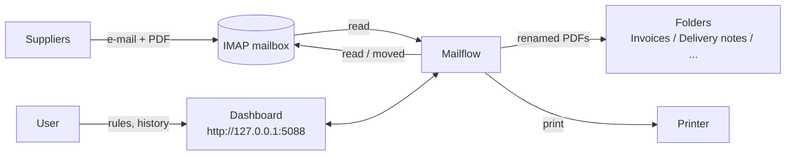
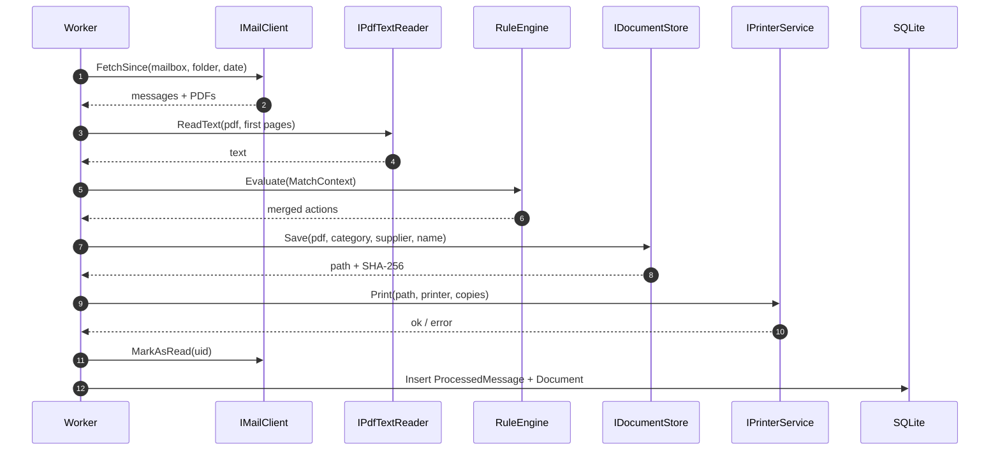
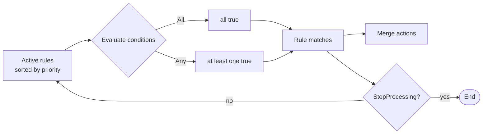
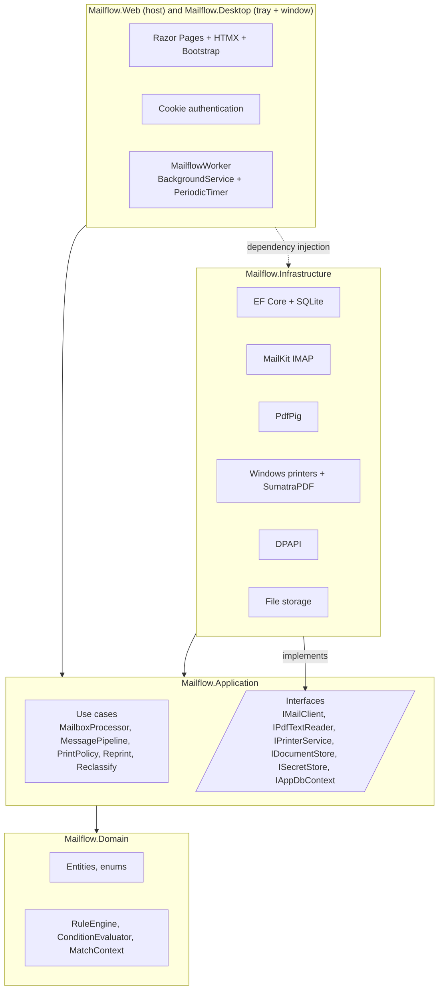

# Mailflow

[Français](README.fr.md) | **English**

**Sort incoming e-mail, archive PDF attachments and print the ones you choose, automatically.**
Free, lightweight, open source (MIT). Windows, .NET 10.

> **Status:** early release. Review the security model below before relying on automatic printing.

## Contents

1. [What it does](#what-it-does)
2. [Features](#features)
3. [How it works](#how-it-works)
4. [Quick start](#quick-start)
5. [Configuration](#configuration)
6. [Rules](#rules)
7. [Security model](#security-model)
8. [Architecture and tech stack](#architecture-and-tech-stack)
9. [Project layout](#project-layout)
10. [Build, test, release](#build-test-release)
11. [Roadmap](#roadmap)
12. [Contributing and license](#contributing-and-license)

## What it does

Mailflow runs on an always-on Windows PC. It:

1. **Reads** one or more IMAP mailboxes (OVH, iCloud, Gmail, Yahoo, any IMAP server).
2. **Sorts** incoming messages and their PDF attachments (invoices, delivery notes, credit notes, orders...) with configurable rules.
3. **Saves** a renamed copy of each PDF in an organised folder tree.
4. **Prints** the documents you choose on a local printer.
5. **Marks messages as read**, moves them, or leaves them alone, depending on the rule.
6. Is **managed from a local web dashboard**, available in French and English.

It never deletes an e-mail and never opens or runs an attachment.



Mailflow is designed for a single site: one installation, one database, one set of printers. Which documents are printed is decided only by your rules.

## Features

- Several IMAP mailboxes. Sign in with e-mail address and password; the provider is detected from the address (OVH MX Plan, OVH Email Pro, iCloud, Gmail, Yahoo), and an advanced toggle lets you set provider, server and port by hand. Gmail, iCloud and Yahoo need an app password.
- Rule engine on sender, domain, recipient, subject, body, attachment name, **PDF text** and presence of a PDF. Case- and accent-insensitive; regular expressions with a time limit.
- Archive layout driven by a file-name pattern, with SHA-256 de-duplication.
- Silent printing through SumatraPDF, **only** for recent messages that a rule asks to print. To restrict printing to one sender, add an exact-sender condition to the print rule.
- Optional printing of the e-mail body when a message has no PDF (off by default).
- Per-rule mailbox action: mark as read, move to an IMAP folder, or leave unchanged.
- History with search, PDF opening, **reprint** and re-categorisation; run log, per-mailbox errors, "Run now", pause/resume.
- Folder picker for the documents folder; nightly SQLite backup (last 14 kept).
- Bilingual interface (French by default, English through the FR | EN switch in the top bar) and a built-in **Help** page (`/Help`).
- Light and dark theme.

## How it works

The pipeline runs every *N* minutes per mailbox, and on demand.

```mermaid
flowchart TD
    A[For each active mailbox] --> B[IMAP connection over SSL]
    B --> C[Search SINCE the mailbox "Sort from" date]
    C --> D{Already in<br/>ProcessedMessage?}
    D -- yes --> C
    D -- no --> E[Parse with MimeKit<br/>BODY.PEEK, flags untouched]
    E --> F[Extract PDFs + text of the first pages]
    F --> G[Build MatchContext]
    G --> H[RuleEngine.Evaluate<br/>rules by priority]
    H --> I{No rule matched?}
    I -- yes --> I1[Default: category "To sort",<br/>no print, leave unread]
    I -- no --> J
    I1 --> J[SaveToCategory: store PDFs<br/>SHA-256 de-duplication]
    J --> K{Printing allowed?<br/>a rule asks for it<br/>+ age within limit + sender check + active printer}
    K -- yes --> L[Print via SumatraPDF]
    K -- no --> M
    L --> M{Saved successfully?}
    M -- yes --> N[Mailbox action:<br/>read / move / leave]
    M -- no --> R[Nothing recorded,<br/>retried on the next pass]
    N --> O[(Insert ProcessedMessage<br/>one transaction per message)]
    O --> C
    C -->|done| P[Write RunLog,<br/>update LastCheckAt / LastError]
```

| Situation | Result |
|---|---|
| Saving fails | Message not recorded and **not marked as read**: retried on the next pass |
| Printing fails | Document saved, `PrintError` kept, **Reprint** button in History |
| Mailbox unreachable | Error shown on the home page; other mailboxes continue |
| Always | An e-mail is never deleted; an attachment is never opened or executed |



## Quick start

### Install (Windows 10/11)

Download `Mailflow-Setup-<version>-win-x64.exe` from the releases page and run it. The wizard (French or English) installs Mailflow for the current user, with an uninstaller, an optional start with Windows and an optional desktop shortcut. It can also run unattended; see [deploy/build-release.ps1](deploy/build-release.ps1) and [deploy/installer/SetupProgram.cs](deploy/installer/SetupProgram.cs) for how the installer is built and the switches it accepts.

Start Mailflow. A window shows the dashboard (Microsoft Edge WebView2 is required; it is present by default on Windows 11) and an icon appears in the notification area. Closing the window hides it and Mailflow keeps working in the background. Right-click the icon to open the dashboard, run now, pause/resume or quit. Only one instance runs at a time. `Mailflow.exe --minimized` starts in the notification area; `--headless` runs the server without a window.

On first launch a setup page, reachable from the local machine only, asks you to choose the administrator password. Then add a mailbox, a printer, categories and rules. The **Help** page walks through each step.


### Run from source

Requirements: Windows, the [.NET 10 SDK](https://dotnet.microsoft.com/download), Git, and a printer installed on the machine.

```powershell
git clone https://github.com/ArmSal/mailflow.git
cd mailflow
dotnet run --project src/Mailflow.Web
```

Open **http://127.0.0.1:5088** and set the administrator password. To print, download the portable 64-bit SumatraPDF and place `SumatraPDF.exe` in `tools/SumatraPDF/` (see [tools/SumatraPDF/README.md](tools/SumatraPDF/README.md)).

## Configuration

Almost everything is configured in the dashboard and stored in the SQLite database (`data/mailflow.db` next to the application). Only the listening URL, the polling interval and logging live in `src/Mailflow.Web/appsettings.json`.

```json
{
  "Kestrel": { "Endpoints": { "Http": { "Url": "http://127.0.0.1:5088" } } },
  "Worker": { "Interval": "00:01:00" }
}
```

Other ways to change the port:

```powershell
dotnet run --project src/Mailflow.Web --urls "http://127.0.0.1:5099"
$env:ASPNETCORE_URLS = "http://127.0.0.1:5099"
```

Keep `127.0.0.1` so the dashboard stays local.

**Settings page:** documents folder (with a folder picker), file-name pattern, printing the e-mail body when there is no PDF, sender verification mode, administrator password, immediate backup.

**Language:** use the FR | EN switch in the top bar. The choice is stored in a cookie; French is the default.

## Rules

Rules are evaluated by priority. Each rule has conditions (all or any must match) and actions: save to a category, print on a printer (with a number of copies), mark as read, move to an IMAP folder, leave unread, skip. The rule editor can **test a rule** against the 50 most recent messages without changing anything.



Example:

| Field | Value |
|---|---|
| Name | Supplier X invoices |
| Mode | All |
| Conditions | `FromAddress` equals `billing@supplier-x.example` and `PdfText` contains "INVOICE" |
| Actions | save to "Invoices", print on the office printer (1 copy), mark as read |

Comparisons ignore case and accents by default. For `PdfText` with `Contains`, the keyword nearest the top wins, so an invoice that mentions "delivery note" further down stays an invoice. Regular expressions time out after 100 ms.

## Security model

| Risk | Mitigation |
|---|---|
| Dashboard access from the network or other users | Bound to `127.0.0.1`; hashed password; 30-minute session; anti-forgery tokens on every form; login rate limit (5 per minute); `AllowedHosts` limited to localhost; first-run setup only from the local machine |
| Sender spoofing (the `From` header is forgeable) | The address is parsed strictly and ambiguous addresses are ignored. Optional check of the receiving server's DKIM/DMARC verdict (Settings): **Off**, **Warn** (default: printing unchanged, History flags unverified senders) or **Strict** (only verified senders are printed; the others are archived and can be reprinted). A missing verdict counts as unverified |
| Unwanted printing | Nothing prints unless a rule says so, and printing is controlled by the rules alone: add an exact-sender condition to a print rule to limit it to one sender. Messages older than the mailbox's "print the last N days" limit (1 to 7, default 1) are never printed |
| Mailbox passwords | Encrypted with Windows **DPAPI** (scope: the Windows account running Mailflow); write-only in the UI |
| Malicious PDFs | Never opened or executed: only text is read (PdfPig); SumatraPDF only prints |
| Path traversal | Documents are opened by id, never by a browser-supplied path; folder and pattern settings reject `..` and absolute patterns |
| Remote access | Local only (`127.0.0.1`). If you need remote access, use a private network such as Tailscale rather than opening a port |
| Data loss | Nightly SQLite backup (`VACUUM INTO`), last 14 kept |

DPAPI ties a password to one Windows account: a password saved under another account cannot be decrypted by the account that runs Mailflow, so enter passwords after choosing how Mailflow runs.

Report vulnerabilities privately through GitHub Security Advisories, not in public issues.

## Architecture and tech stack

Clean Architecture: `Domain` <- `Application` <- `Infrastructure` <- `Web` / `Desktop`. Nothing depends upward; the core talks to the outside world through interfaces.



| Area | Choice |
|---|---|
| Runtime | .NET 10 |
| Dashboard | ASP.NET Core Razor Pages, HTMX, Bootstrap 5 (static files, no CDN) |
| Desktop shell | Windows Forms + WebView2 (window and notification-area icon) |
| Database | SQLite with EF Core (code first, migrations applied at startup) |
| IMAP | MailKit / MimeKit |
| PDF text | PdfPig |
| Printing | SumatraPDF (silent command line); printers listed through `System.Drawing.Common` |
| Secrets | Windows DPAPI |
| Logging | Serilog (rolling files + run log table) |
| Localization | `Loc.T("French text")` with JSON dictionaries (French source, English translation) |
| Tests | xUnit, NSubstitute |

## Project layout

```
Mailflow.slnx
src/
  Mailflow.Domain/           entities, enums, rule engine
  Mailflow.Application/      use cases and interfaces
  Mailflow.Infrastructure/   EF Core, MailKit, PdfPig, printing, DPAPI, file storage
  Mailflow.Web/              dashboard, worker, host, localization
  Mailflow.Desktop/          tray icon and window around the web host
tests/
  Mailflow.Domain.Tests/        Mailflow.Application.Tests/
  Mailflow.Integration.Tests/   Mailflow.Desktop.Tests/
tools/SumatraPDF/            portable executable (not committed)
deploy/                      release build and installer
Docs/                        design system
```

## Build, test, release

```powershell
dotnet build
dotnet test
```

To build a release from a development machine:

```powershell
.\deploy\build-release.ps1 -Version 1.0.0
```

This publishes a self-contained win-x64 build and writes `dist\Mailflow-Setup-<version>-win-x64.exe` (FR/EN wizard, no administrator rights needed, uninstaller included) and the matching zip. Put `SumatraPDF.exe` in `tools\SumatraPDF\` first if you want printing in the package: see [tools/SumatraPDF/README.md](tools/SumatraPDF/README.md). Unattended install: `Mailflow-Setup-<version>-win-x64.exe /S /dir=C:\Mailflow /nostartup /nodesktop /noRun /lang=en` (also `/nostartmenu`, `/nowebview2`); the uninstaller takes `/S` (keeps your data) and `/removedata`.

To update, install the new version over the old one; database migrations are applied at startup.

## Roadmap

- Daily digest of what needs attention
- Backup of documents to a synced folder (Google Drive, OneDrive)
- OCR for scanned PDFs
- More provider presets
- Remote printing: a small Print Agent installed on the PC that owns the printer, polling Mailflow over HTTPS for jobs (token per agent, no open ports), so Mailflow can run on another PC. The printer type "PrintNode" in the printer form is a placeholder for this and currently prints locally like "Local"

## Contributing and license

See [CONTRIBUTING.md](CONTRIBUTING.md) for conventions, migrations, tests, provider presets and UI translations. Mailflow is licensed under the [MIT License](LICENSE). It uses third-party components under their own licences, listed in [THIRD-PARTY-NOTICES.md](THIRD-PARTY-NOTICES.md). In particular, the installer bundles the portable [SumatraPDF](https://github.com/sumatrapdfreader/sumatrapdf) (GPL v3) as a separate, unmodified program used for printing; it is not covered by the MIT licence.
