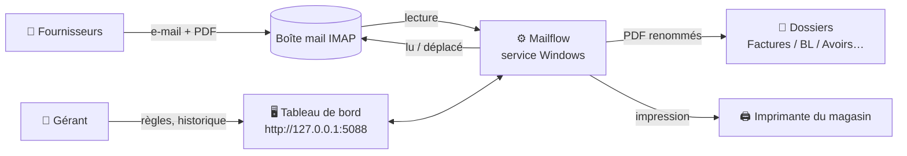
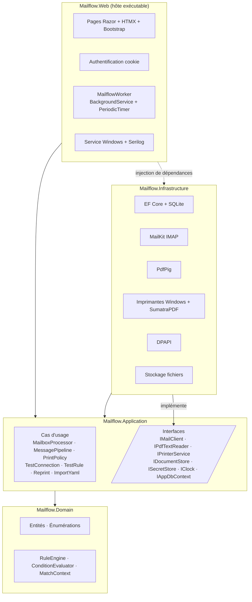
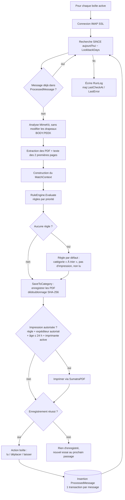
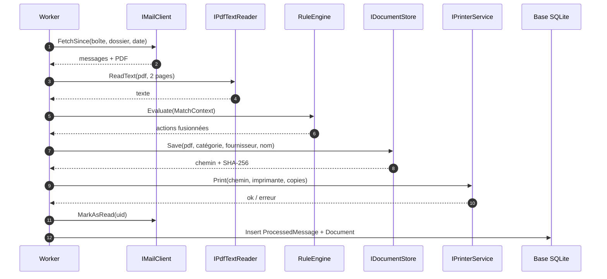
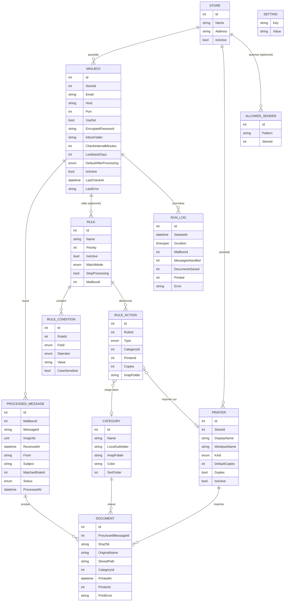
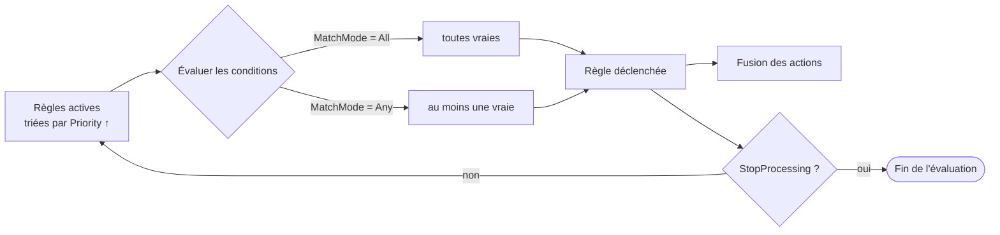
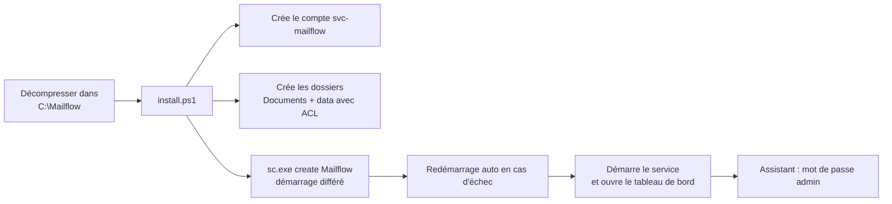

# 📬 Mailflow

**Tri des e-mails, archivage des PDF et impression automatique pour les petits commerces.**
Gratuit, léger, open source (licence MIT).


> **Statut : développement précoce.** Les contrats (entités, interfaces) sont figés (`contracts-v1`), la construction parallèle des briques est en cours. Ne pas utiliser en production.

---

## Sommaire

1. [Présentation](#1-présentation)
2. [Fonctionnalités](#2-fonctionnalités)
3. [Architecture](#3-architecture)
4. [Fonctionnement : le pipeline de traitement](#4-fonctionnement--le-pipeline-de-traitement)
5. [Modèle de données](#5-modèle-de-données)
6. [Moteur de règles](#6-moteur-de-règles)
7. [Tableau de bord](#7-tableau-de-bord)
8. [Sécurité](#8-sécurité)
9. [Pile technique](#9-pile-technique)
10. [Prérequis](#10-prérequis)
11. [Démarrage rapide](#11-démarrage-rapide)
12. [Configuration](#12-configuration)
13. [Tests](#13-tests)
14. [Déploiement en service Windows](#14-déploiement-en-service-windows)
15. [Structure du dépôt](#15-structure-du-dépôt)
16. [Plan de développement parallèle](#16-plan-de-développement-parallèle)
17. [Feuille de route](#17-feuille-de-route)
18. [Contribuer](#18-contribuer)
19. [Licence](#19-licence)

---

## 1. Présentation

Mailflow est une application Windows installée sur le PC toujours allumé d'un magasin. Elle :

1. **Lit** une ou plusieurs boîtes mail (OVH, iCloud, Gmail, tout serveur IMAP).
2. **Trie** les e-mails entrants et leurs PDF (factures, bons de livraison, avoirs, commandes…) selon des règles configurables.
3. **Enregistre** une copie renommée de chaque PDF dans des dossiers organisés.
4. **Imprime** les documents choisis sur l'imprimante locale du magasin.
5. **Marque les e-mails comme lus**, les déplace, ou n'y touche pas, selon la règle.
6. Se **pilote entièrement depuis un tableau de bord web** : boîtes, magasins, imprimantes, dossiers et règles se modifient sans toucher au code.



### Hors périmètre de la v1

| Prévu | Version |
|---|---|
| Récapitulatif quotidien de ce qu'il faut lire | v2 |
| Sauvegarde cloud (simple dossier Google Drive / OneDrive) | v2 |
| Impression multi-magasins (PrintNode ou une installation par magasin) | v3 |
| OCR des PDF scannés | v3 |

### Contraintes

| Contrainte | Comment elle est respectée |
|---|---|
| Gratuit | .NET, toutes les bibliothèques et SumatraPDF sont libres |
| Léger | Un seul service Windows, ~60–120 Mo de RAM, ~0 % CPU entre deux relevés |
| Configurable | Tous les réglages sont en base de données, modifiables depuis le tableau de bord |
| Sûr | Ne supprime jamais un e-mail, n'imprime que depuis des expéditeurs approuvés, mots de passe chiffrés |

---

## 2. Fonctionnalités

- 📥 Lecture IMAP multi-boîtes avec préréglages (OVH MX Plan, OVH Email Pro, iCloud, Gmail, Outlook / Hotmail, Yahoo) et option « IMAP personnalisé »
- 🧠 Moteur de règles : expéditeur, domaine, objet, corps, nom de pièce jointe, **texte du PDF** (insensible à la casse et aux accents, regex avec délai maximal)
- 🗂️ Archivage : `{Catégorie}/{aaaa}/{MM}/{aaaa-MM-jj}_{Fournisseur}_{NomOriginal}.pdf`, dédoublonnage par SHA-256
- 🖨️ Impression silencieuse via SumatraPDF, **uniquement** pour les expéditeurs autorisés et les e-mails récents
- 📬 Action sur la boîte par règle : marquer comme lu, déplacer dans un dossier IMAP, ou laisser tel quel
- 🔎 Historique : recherche, ouverture du PDF, **réimpression**, changement de catégorie
- 📊 Journal d'exécution, erreurs par boîte, bouton « Lancer maintenant », pause / reprise
- 💾 Sauvegarde nocturne de la base SQLite

---

## 3. Architecture

Architecture propre (*Clean Architecture*). Le domaine ne dépend de rien ; l'application définit des interfaces ; l'infrastructure les implémente ; le projet Web est le seul exécutable.



**Règle d'or :** `Domain` ← `Application` ← `Infrastructure` ← `Web`. Aucune dépendance ne remonte.

---

## 4. Fonctionnement : le pipeline de traitement

Exécuté toutes les *N* minutes par boîte, et à la demande (« Lancer maintenant »).



### Comportement en cas d'échec

| Situation | Résultat |
|---|---|
| Enregistrement impossible | Message non enregistré, **non marqué comme lu** → nouvel essai au prochain passage |
| Impression en échec | Document enregistré, `PrintError` conservé, bouton **Réimprimer** dans l'historique |
| Boîte injoignable | Erreur affichée sur l'accueil, les autres boîtes continuent |
| Dans tous les cas | **Jamais** de suppression d'e-mail, **jamais** d'ouverture ni d'exécution de pièce jointe |

### Séquence d'un message imprimé



---

## 5. Modèle de données



### Énumérations

| Énumération | Valeurs |
|---|---|
| `ConditionField` | `FromAddress`, `FromDomain`, `ToAddress`, `Subject`, `Body`, `AttachmentName`, `PdfText`, `HasPdf` |
| `ConditionOperator` | `Contains`, `NotContains`, `Equals`, `StartsWith`, `EndsWith`, `Regex` |
| `ActionType` | `SaveToCategory`, `Print`, `MarkAsRead`, `MoveToFolder`, `LeaveUnread`, `Skip` |
| `AfterProcessing` | `MarkRead`, `Move`, `Leave` |
| `MatchMode` | `All`, `Any` |

---

## 6. Moteur de règles

Logique pure dans `Domain`, entièrement testée unitairement.



- Comparaison **insensible à la casse et aux accents** par défaut (« Facture » = « facture » = « FACTURÉ »).
- `PdfText` + `Contains` : option « le mot-clé le plus proche du haut gagne » (une facture qui mentionne « bon de livraison n° … » plus bas reste une facture).
- Regex avec **délai de 100 ms** pour éviter les blocages.

**Exemple de règle**

| Champ | Valeur |
|---|---|
| Nom | Factures Fournisseur X |
| Mode | Tous |
| Conditions | `FromDomain` égal à `fournisseur-x.fr` · `PdfText` contient « FACTURE » |
| Actions | `SaveToCategory` → Factures · `Print` → imprimante du magasin (1 copie) · `MarkAsRead` |

---

## 7. Tableau de bord

Adresse par défaut : **http://127.0.0.1:5088** (liée à `127.0.0.1`). Connexion obligatoire. Libellés en français.

| Page | Contenu |
|---|---|
| **Accueil** | État du worker, dernier / prochain passage, compteurs du jour, dernières erreurs, **Lancer maintenant**, **Pause / Reprise**, 10 derniers documents |
| **Magasins** | CRUD ; chaque magasin affiche ses boîtes et ses imprimantes |
| **Boîtes mail** | CRUD, préréglages fournisseurs, mot de passe en écriture seule, **Tester la connexion** (nombre de messages + dossiers serveur) |
| **Imprimantes** | **Détecter les imprimantes**, rattachement au magasin, copies, recto-verso, **Test d'impression** |
| **Catégories / Dossiers** | CRUD, sous-dossier local avec vérification du chemin, dossier IMAP choisi ou créé, couleur |
| **Règles** | Liste ordonnée (glisser-déposer), éditeur conditions / actions, **Tester cette règle** sur les 50 derniers e-mails (lecture seule), **Expéditeurs autorisés** |
| **Historique** | Recherche par date / fournisseur / catégorie / magasin, **Ouvrir le PDF**, **Réimprimer**, **Changer de catégorie** |
| **Journal** | Exécutions et erreurs |
| **Paramètres** | Dossier racine des documents, modèle de nom de fichier, âge maximal d'impression, mot de passe admin, sauvegarde immédiate, **Import config.yaml** |

Principes d'interface : Bootstrap 5, HTMX pour les actions en ligne (tests, interrupteurs, « lancer maintenant »). Pas de SPA, pas d'étape de build front.

---

## 8. Sécurité

| Risque | Parade |
|---|---|
| Accès au tableau de bord par le personnel / le réseau | Lié à `127.0.0.1`, mot de passe haché, session de 30 min, jetons anti-falsification sur tous les formulaires, 5 tentatives de connexion par minute, hôtes autorisés limités à `localhost` (`AllowedHosts`), assistant de premier lancement accessible uniquement depuis la machine locale |
| Usurpation de l'expéditeur (en-tête `From` falsifiable) | L'adresse est analysée strictement (toute adresse ambiguë est ignorée). La vérification DKIM/DMARC avant impression n'est **pas encore** en place : ne mettez dans les expéditeurs autorisés que des fournisseurs de confiance |
| Mots de passe des boîtes | Chiffrés avec **DPAPI** (portée : compte du service), jamais affichés |
| Impression sauvage | Impression uniquement depuis les **expéditeurs autorisés**, âge maximal 24 h |
| PDF malveillants | Jamais ouverts ni exécutés : seul le texte est lu (PdfPig) ; SumatraPDF ne fait qu'imprimer |
| Personnel qui consulte les factures | Service sous compte local dédié `svc-mailflow` ; ACL sur le dossier de documents |
| Accès distant (plus tard) | **Tailscale**, aucun port ouvert sur la box |
| Perte de données | Sauvegarde SQLite nocturne (`VACUUM INTO`) |

> ⚠️ DPAPI est lié au compte Windows. Un mot de passe saisi sous votre compte ne peut pas être déchiffré par le compte du service : **saisissez les mots de passe après l'installation du service**.

---

## 9. Pile technique

| Domaine | Choix |
|---|---|
| Exécution | **.NET 10 (LTS)** |
| Hôte | Generic Host + service Windows (`Microsoft.Extensions.Hosting.WindowsServices`) |
| Tableau de bord | ASP.NET Core Razor Pages + HTMX + Bootstrap 5 (fichiers statiques, sans CDN) |
| Base de données | SQLite + EF Core (code-first, migrations) |
| E-mail IMAP | MailKit / MimeKit |
| Texte PDF | PdfPig (`UglyToad.PdfPig`) |
| Liste des imprimantes | `PrinterSettings.InstalledPrinters` (`System.Drawing.Common`) |
| Impression PDF | SumatraPDF (ligne de commande silencieuse), livré à côté de l'application |
| Secrets | Windows DPAPI (`ProtectedData`) |
| Authentification | Cookie + `PasswordHasher` d'Identity (uniquement le hachage) |
| Journalisation | Serilog → fichiers tournants + table pour la page Journal |
| Planification | `BackgroundService` + `PeriodicTimer` |
| Tests | xUnit + NSubstitute ; GreenMail (Docker) pour l'IMAP |

---

## 10. Prérequis

- Windows 10 / 11 (DPAPI, détection des imprimantes et service Windows : Windows uniquement)
- [Kit SDK .NET 10](https://dotnet.microsoft.com/download) : `winget install Microsoft.DotNet.SDK.10`
- Git
- Une imprimante installée **pour tous les utilisateurs** (sinon le compte du service ne la voit pas)
- Facultatif : Docker (GreenMail pour les tests IMAP) ; Visual Studio 2026, Rider ou VS Code + C# Dev Kit

---

## 11. Démarrage rapide

**Utilisateur** : décompressez la version et double-cliquez sur `Mailflow.exe`. Une fenêtre affiche le tableau de bord (Microsoft Edge WebView2 requis, présent par défaut sur Windows 11) et une icône apparaît dans la zone de notification. Fermer la fenêtre la masque : Mailflow continue de travailler en arrière-plan. Clic droit sur l'icône : ouvrir, lancer le traitement maintenant, mettre en pause / reprendre, quitter. Une seule instance à la fois ; si le service Windows tourne déjà, la fenêtre s'y connecte (pause et traitement immédiat se font alors depuis le tableau de bord). `Mailflow.exe --minimized` démarre directement dans la zone de notification ; `--headless` (ou le mode service) lance le serveur sans fenêtre.

**Développeur** :

```powershell
git clone https://github.com/<votre-compte>/mailflow.git
cd mailflow
dotnet build
dotnet test
dotnet run --project src/Mailflow.Web
```

Ouvrez ensuite **http://127.0.0.1:5088** et définissez le mot de passe administrateur dans l'assistant de premier lancement.

> Lancer VS Code en administrateur n'est nécessaire que pour **installer le service Windows**, pas pour développer.

---

## 12. Configuration

Seuls l'URL / le port, le chemin de la base et le chemin des journaux sont dans `appsettings.json`. Tout le reste est en base de données.

**Changer le port** (`src/Mailflow.Web/appsettings.json`) :

```json
{
  "Kestrel": { "Endpoints": { "Http": { "Url": "http://127.0.0.1:5088" } } }
}
```

Autres façons :

```powershell
dotnet run --project src/Mailflow.Web --urls "http://127.0.0.1:5099"
$env:ASPNETCORE_URLS = "http://127.0.0.1:5099"
```

Choisissez un port supérieur à 1024 et libre (`netstat -ano | findstr :5088`). Gardez `127.0.0.1` pour que le tableau de bord reste local.

---

## 13. Tests

| Niveau | Contenu | Outil |
|---|---|---|
| Unitaire | Moteur de règles : chaque champ × opérateur, accents, priorité, arrêt, « mot-clé le plus proche » | xUnit |
| Unitaire | `PrintPolicy`, nommage des fichiers, dédoublonnage | xUnit |
| Application | `MessagePipeline` avec faux client mail / imprimante / stockage : « lu » seulement après enregistrement, reprises, échecs | xUnit + NSubstitute |
| Intégration | Flux IMAP réel contre **GreenMail** | xUnit + Docker |
| Manuel (PC du magasin) | Boîte réelle en mode « tester la règle », test d'impression, 1 semaine pilote en `LeaveUnread` avant `MarkAsRead` | liste de contrôle |

Serveur IMAP de test :

```powershell
docker run -p 3143:3143 -p 3025:3025 greenmail/standalone
```

Les PDF d'exemple (anonymisés) vont dans `tests/fixtures/`.

---

## 14. Déploiement en service Windows

**Construire** (poste de développement) :

```powershell
.\deploy\build-release.ps1 -Version 1.0.0
```

Le script produit `dist\Mailflow-1.0.0-win-x64.zip` (application autonome, aucun .NET à installer sur le PC du magasin). Ajoutez ensuite `SumatraPDF.exe` (version portable) dans `tools\SumatraPDF\` : voir [tools/SumatraPDF/README.md](tools/SumatraPDF/README.md).

**Installer** (PC du magasin, PowerShell **administrateur**) :



**Mise à jour :** arrêter le service → remplacer l'exécutable → redémarrer (les migrations EF s'appliquent au démarrage).

**Objectifs de ressources :** RAM au repos ≤ 120 Mo · CPU ~0 % entre deux relevés · passage sans nouveau mail < 3 s · ~125 Mo de disque pour l'application (autonome, avec le runtime .NET) · ~1–2 Go/an/magasin pour les documents · priorité du service « inférieure à la normale » (la caisse reste prioritaire).

---

## 15. Structure du dépôt

```
Mailflow.slnx
├── src/
│   ├── Mailflow.Domain/           entités, énumérations, moteur de règles
│   ├── Mailflow.Application/      cas d'usage et interfaces
│   ├── Mailflow.Infrastructure/   EF Core, MailKit, PdfPig, impression, DPAPI, fichiers
│   └── Mailflow.Web/              tableau de bord, worker, hôte
├── tests/
│   ├── Mailflow.Domain.Tests/
│   ├── Mailflow.Application.Tests/
│   └── Mailflow.Integration.Tests/
├── tools/SumatraPDF/                   exécutable portable
├── deploy/                             install.ps1 · uninstall.ps1
└── Docs/                               plan du projet · plan de développement parallèle
```

---

## 16. Plan de développement parallèle

Le projet est découpé en vagues pour être construit par **3 à 10 contributeurs ou agents en parallèle**. Chacun possède ses dossiers ; les contrats (`contracts-v1`) sont figés avant le départ.

```mermaid
flowchart LR
    W0[Vague 0<br/>Fondations + contrats<br/>1 agent] --> W1
    subgraph W1[Vague 1 : construction parallèle]
        direction TB
        A1[A1 Moteur de règles]
        A2[A2 Persistance]
        A3[A3 Mail IMAP]
        A4[A4 PDF + stockage]
        A5[A5 Impression + secrets]
        A6[A6 Socle Web]
        A7[A7 Pages CRUD]
        A8[A8 Pages règles]
        A9[A9 Pipeline]
        A10[A10 Worker + déploiement]
    end
    W1 --> W2[Vague 2<br/>Historique · Accueil/Journal · Paramètres]
    W2 --> W3[Vague 3<br/>Tests d'intégration · Revue sécurité · Release]
    W3 --> P[Pilote]
```



| Nombre d'agents | Regroupement |
|---|---|
| 3 | Logique (A1+A9+A10) · Infrastructure (A2+A3+A4+A5) · Web (A6+A7+A8) |
| **5** | A1+A9 · A2+A4 · A3+A5 · A6+A10 · A7+A8 |
| 10 | Un agent par ligne |

Détails complets : [Docs/Parallel-Development-Plan.md](Docs/Parallel-Development-Plan.md). Plan général : [Docs/Mailflow-dotnet-plan.md](Docs/Mailflow-dotnet-plan.md).

---

## 17. Feuille de route

| Phase | Contenu | Terminé quand… |
|---|---|---|
| 0 | Solution, 4 projets + tests, contrats | `dotnet build` vert ✅ |
| 1 | Hôte, connexion, assistant, Accueil, Paramètres | Installé en service sur un PC de test |
| 2 | Magasins et boîtes, DPAPI, **Test de connexion** | Une boîte réelle se connecte |
| 3 | Imprimantes, **Test d'impression** via le service | Une page de test s'imprime depuis le compte du service |
| 4 | Catégories et règles, expéditeurs autorisés, **Tester la règle** | Les règles de 3 fournisseurs principaux fonctionnent sur de vrais e-mails |
| 5 | Worker : pipeline, dédoublonnage, politique d'impression | 48 h sans document manqué ni imprimé deux fois |
| 6 | Historique, réimpression, sauvegarde, import YAML | Semaine pilote terminée |
| v2 | Récapitulatif, cloud, indicateurs « à vérifier » | — |
| v3 | Multi-magasins, PrintNode, OCR, Tailscale | Tous les magasins en service |

---

## 18. Contribuer

Pour savoir **où modifier le code** (ajouter un fournisseur, une condition, une action, un backend d'impression ou de stockage), lisez [CONTRIBUTING.md](CONTRIBUTING.md).

1. Ouvrez une *issue* pour discuter du changement.
2. Créez une branche (`feature/<sujet>`).
3. Respectez les couches : `Domain` ne dépend de rien, `Application` définit les interfaces, `Infrastructure` les implémente.
4. Ajoutez des tests (le moteur de règles en particulier) ; `dotnet build` et `dotnet test` doivent passer.
5. Ouvrez une *pull request*.

Ne committez **jamais** d'identifiants de boîte mail, de documents clients ni de factures de fournisseurs. Anonymisez les PDF d'exemple.

**Sécurité :** signalez les vulnérabilités en privé (GitHub Security Advisories), pas dans une issue publique.

---

## 19. Licence

[MIT](LICENSE)
